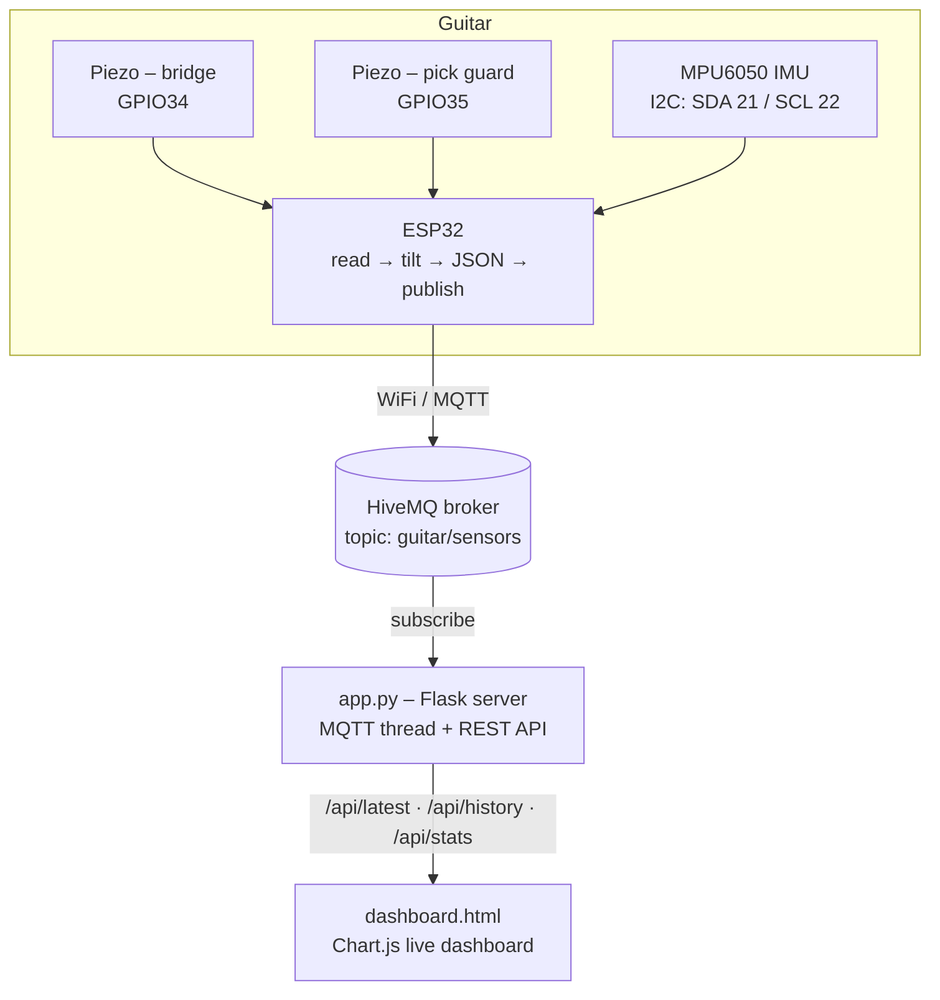

# 🎸 StrumSense

### IoT-based guitar practice analytics using multi-sensor fusion and machine learning

An ESP32 module with two piezo discs and an IMU clips onto a guitar, streams 7 sensor channels over WiFi (MQTT), and a Flask server classifies your technique as **GOOD** or **BAD** in near real time on a live web dashboard.


<!-- Add a dashboard screenshot and a photo of the hardware:

-->

---

## 📑 Table of Contents
- [Why StrumSense?](#-why-strumsense)
- [Key Facts](#-key-facts)
- [System Architecture](#-system-architecture)
- [Hardware & Wiring](#-hardware--wiring)
- [Quick Start](#-quick-start)
- [How It Works](#-how-it-works)
- [Results](#-results)
- [API Reference](#-api-reference)
- [Project Structure](#-project-structure)
- [Limitations & Future Work](#-limitations--future-work)
- [License](#-license)

---

## 💡 Why StrumSense?

Beginner guitarists pick up bad habits, such as wrong neck angle, uncontrolled strumming force and poor posture, without noticing. A teacher isn't always around, and camera-based tools can't sense the *physical* behaviour of the instrument. StrumSense attaches directly to the guitar and acts as a passive, always-on practice coach.

## 📊 Key Facts

| | |
|---|---|
| Sensor channels | 7 (2 piezo + 3-axis accel + gyro-x, plus derived tilt) |
| Sampling rate | 10 Hz (one reading every 100 ms) |
| Transport | MQTT over WiFi (`guitar/sensors` topic) |
| Dashboard refresh | Latest reading polled every 120 ms |
| Training data | 6,868 labelled frames (audio-derived proxies) |
| Engineered features | 11 |
| Classifier in production | Rule-based, 2-of-3 majority vote |
| ML model available | Random Forest (77% accuracy on proxy data) |

## 🏗️ System Architecture



## 🔧 Hardware & Wiring

| Component | Role |
|---|---|
| ESP32 Dev Module | WiFi, ADC, I2C host |
| Piezo disc #1 (bridge) | String resonance / vibration |
| Piezo disc #2 (pick guard) | Strumming impact / force |
| MPU6050 | 3-axis accelerometer + 3-axis gyroscope |
| 1 MΩ resistor × 2 | Across each piezo and GND to protect the ADC |

```text
ESP32 pin   Connects to                Notes
──────────────────────────────────────────────────────────────
GPIO 34  →  Piezo #1 (+), bridge       Input-only ADC1_CH6
GPIO 35  →  Piezo #2 (+), pick guard   Input-only ADC1_CH7
GPIO 21  →  MPU6050 SDA                I2C data
GPIO 22  →  MPU6050 SCL                I2C clock
3.3V     →  MPU6050 VCC
GND      →  All grounds                Common ground

Protection: 1 MΩ resistor across each piezo and GND
```

> GPIO 34/35 are input-only pins, which makes them a safe choice for passive analog sensors.

## 🚀 Quick Start

### 1. Install Python dependencies

```bash
pip install flask flask-cors paho-mqtt scikit-learn pandas numpy joblib librosa
```

### 2. Flash the ESP32

1. Install these libraries from the Arduino IDE Library Manager: **PubSubClient** (Nick O'Leary) and **ArduinoJson** (Benoit Blanchon).
2. Open `esp32_firmware/esp32_firmware.ino`.
3. Set your WiFi credentials in the firmware.
4. Select board **ESP32 Dev Module**, choose your COM port, and upload.

### 3. Get training data

**Option A: with hardware (preferred)**

```bash
python data_collector.py --label good --duration 120 --out guitar_data.csv
python data_collector.py --label bad  --duration 120 --out guitar_data.csv
```

**Option B: without hardware (audio bootstrap)**

```bash
ffmpeg -i good1.mp4 good1.wav        # repeat for good2, bad1, bad2
python audio_to_csv.py --audio good1.wav --label good --out guitar_data.csv
python audio_to_csv.py --audio bad1.wav  --label bad  --out guitar_data.csv
# ...repeat for each recording
```

### 4. Train the model (optional)

```bash
python train_model.py --data guitar_data.csv   # writes model.pkl
```

### 5. Run the server

```bash
python app.py        # API at http://localhost:5000
```

### 6. Open the dashboard

```bash
python -m http.server 8080
# then visit http://localhost:8080/dashboard.html
```

## 🧠 How It Works

### Firmware (`esp32_firmware.ino`)
Every 100 ms the ESP32 reads both piezo channels (12-bit ADC, 0–4095) and the MPU6050 (±2 g, ±250 °/s), computes neck tilt with `atan2(ay, az)`, and publishes JSON. It reconnects to the broker automatically if the connection drops.

```json
{ "ts": 12345, "vibration": 234, "impact": 890, "tilt": 8.4,
  "accel_x": 0.12, "accel_y": 0.97, "accel_z": 0.08, "gyro_x": 1.45 }
```

### Live classifier (`app.py`)
A deterministic **2-of-3 majority vote** over three tunable thresholds, so a single noisy sensor can't condemn a reading:

```python
VIB_THRESHOLD  = 150    # piezo bridge ADC count
IMP_THRESHOLD  = 1000   # piezo pick-guard ADC count
TILT_THRESHOLD = 40     # degrees from boot baseline

fail_count = sum([not vib_ok, not imp_ok, not tilt_ok])
prediction = "good" if fail_count < 2 else "bad"
```

The server keeps the last 100 readings in a `deque(maxlen=100)`, and an MQTT daemon thread runs alongside the Flask app.

### Machine-learning model (`train_model.py`)
A Random Forest (`n_estimators=100`, `max_depth=8`) trained on 11 features: the 7 raw channels plus `vib_rolling_mean`, `vib_rolling_std`, `imp_rolling_mean` (500 ms windows) and `tilt_abs`. Random Forest was chosen for fast inference (< 5 ms), built-in feature importance, and good behaviour on small tabular datasets.

### Training-data bootstrap (`audio_to_csv.py`)
The hardware wasn't built yet when the ML pipeline was, so training data was bootstrapped from ~11.4 minutes of guitar recordings. Each 100 ms audio chunk is converted into a sensor **proxy**:

| CSV column | Audio feature |
|---|---|
| `vibration` | RMS energy × 4095 |
| `impact` | Peak amplitude × 4095 |
| `tilt` | Spectral centroid ÷ 200 |
| `accel_x` | Onset strength ÷ 10 |
| `accel_y` | Zero-crossing rate × 10 |
| `accel_z` | Spectral rolloff ÷ 5000 |
| `gyro_x` | Amplitude std × 50 |

> ⚠️ These are audio-derived proxies, **not real sensor readings**. Retrain on real ESP32 data once you have it.

## 📈 Results

On a stratified 80/20 split (5,494 train / 1,374 test), using the audio-proxy dataset:

| Class | Precision | Recall | F1 | Support |
|---|---|---|---|---|
| bad | 0.81 | 0.74 | 0.77 | 737 |
| good | 0.73 | 0.80 | 0.76 | 637 |
| **Accuracy** | | | **0.77** | 1374 |

<details>
<summary><b>Confusion matrix & feature importance</b></summary>

|  | Pred: bad | Pred: good |
|---|---|---|
| **Actual bad** | 544 | 193 |
| **Actual good** | 128 | 509 |

| Rank | Feature | Importance |
|---|---|---|
| 1 | `imp_rolling_mean` | 0.201 |
| 2 | `vib_rolling_mean` | 0.148 |
| 3 | `accel_z` | 0.115 |
| 4 | `accel_y` | 0.112 |
| 5 | `tilt` | 0.088 |
| 6 | `tilt_abs` | 0.088 |
| 7 | `accel_x` | 0.058 |
| 8 | `impact` | 0.052 |
| 9 | `vib_rolling_std` | 0.048 |
| 10 | `vibration` | 0.046 |
| 11 | `gyro_x` | 0.043 |

Rolling-window features dominate, which suggests that consistency over time matters more than any single instantaneous reading.
</details>

<details>
<summary><b>Parameter ranges: good vs. bad technique (proxy data)</b></summary>

| Parameter | Good (mean ± std) | Bad (mean ± std) |
|---|---|---|
| vibration | 254.5 ± 146.7 | 341.2 ± 200.4 |
| impact | 835.6 ± 532.7 | 1144.6 ± 727.6 |
| tilt (°) | 6.66 ± 2.37 | 7.82 ± 3.69 |
| accel_x | 0.129 ± 0.138 | 0.147 ± 0.138 |
| accel_y | 0.359 ± 0.205 | 0.378 ± 0.281 |
| accel_z | 0.542 ± 0.227 | 0.662 ± 0.344 |
| gyro_x | 1.876 ± 1.129 | 2.489 ± 1.495 |

Good playing is consistently lower and calmer; bad playing shows higher variance. `impact` differs most (+37% for bad), and `gyro_x` is ~33% higher.
</details>

## 🔌 API Reference

Base URL: `http://localhost:5000`

| Endpoint | Description |
|---|---|
| `GET /api/latest` | Most recent reading + prediction |
| `GET /api/history` | Last 100 readings (JSON array) |
| `GET /api/stats` | Session duration, good/bad counts and percentages |

Example reading:

```json
{
  "vibration": 234, "impact": 890, "tilt": 8.4,
  "accel_x": 0.12, "accel_y": 0.97, "accel_z": 0.08, "gyro_x": 1.45,
  "server_ts": "2026-10-18T01:00:00",
  "prediction": "good", "confidence": 100,
  "vib_ok": true, "imp_ok": true, "tilt_ok": true, "fail_count": 0
}
```

## 🗂️ Project Structure

```text
strumsense/
├── esp32_firmware/
│   └── esp32_firmware.ino   # ESP32 sensor reader + MQTT publisher
├── app.py                   # Flask server + MQTT subscriber + classifier
├── dashboard.html           # Live dashboard (HTML/CSS/JS + Chart.js)
├── audio_to_csv.py          # Audio → sensor-proxy dataset builder
├── data_collector.py        # Live MQTT logger for real labelled data
├── train_model.py           # Random Forest training
├── guitar_data.csv          # 6,868-row proxy dataset
└── model.pkl                # Serialized RF + LabelEncoder
```

## 🚧 Limitations & Future Work

| Limitation | Impact |
|---|---|
| ML model trained on audio proxies | 77% accuracy; real sensor data will behave differently |
| Production classifier is rule-based | Thresholds are fixed, not tuned per player or guitar |
| Binary output only | Can't say *which* bad habit occurred |
| Public MQTT broker (HiveMQ) | Unencrypted and world-readable, so not safe for real use |
| No "not playing" detection | Idle or moving guitar may trigger false classifications |

**Planned improvements**
- [ ] Retrain on real ESP32 sensor data
- [ ] Multi-class labels (`muted`, `correct_chord`, `wrong_chord`, `arpeggiated`)
- [ ] Sequence-aware model (LSTM / 1D-CNN)
- [ ] Per-player calibration session
- [ ] Private Mosquitto broker with TLS and authentication
- [ ] React Native mobile dashboard
- [ ] Battery-powered module (LiPo + ESP32 deep sleep)

## 📄 License

Add a license (e.g. MIT) — see [choosealicense.com](https://choosealicense.com/).
